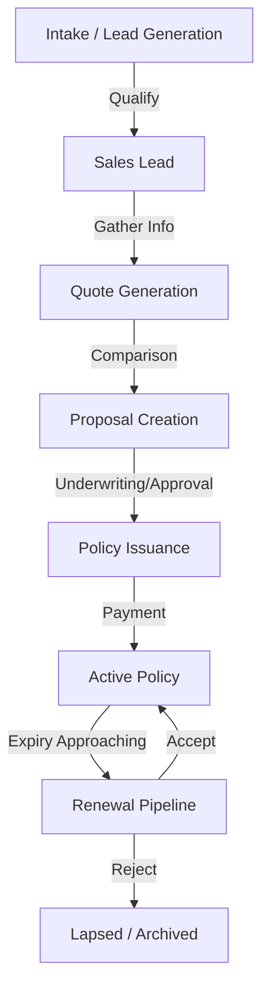
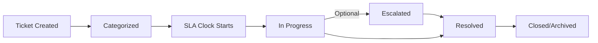
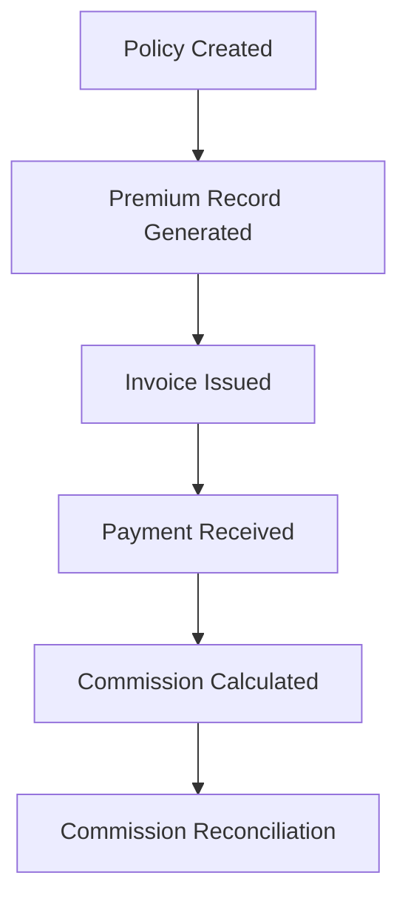

# BP & AF Insurance CRM - Business Flow Documentation

This document outlines the core operational flows within the BP & AF Insurance CRM, from customer acquisition to policy lifecycle management and support.

## 1. Customer & Policy Lifecycle (The "Happy Path")

The primary flow of the system follows the journey of a prospect becoming a policyholder.

### Flow Steps:
1. **Intake**: New inquiries enter through the `Intake` module.
2. **Sales Leads**: Qualified inquiries are tracked as `Sales Leads`, where follow-ups are managed via `Lead Reminders`.
3. **Quotes & Proposals**: Once the customer's needs are defined, `Quotes` are generated and converted into a `Proposal`.
4. **Policy Issuance**: After the proposal is accepted and the premium is confirmed, a `Policy` record is created.
5. **Renewal**: 30-60 days before expiry, the policy automatically enters the `Renewal Pipeline`.

---

## 2. Service Desk & Support Flow

Handles post-issuance requests like E-Cards, endorsements, or queries.

### Key Logic:
- **SLA Engine**: Every ticket is assigned an `SLA Deadline` based on its category and priority (configured in `sla_config`).
- **Escalation**: If a ticket isn't resolved within the SLA, the `escalation_level` increases, triggering notifications to managers.
- **Audit Log**: Every status change or note added is recorded in the `ticket_activity_log`.

---

## 3. Financial & Commission Flow

Manages the money trail from premium to broker commission.

### Key Logic:
- **Commission Rules**: Automatically determined by `policy_type`, `insurer_name`, and `premium_amount`.
- **Reconciliation**: Matches the expected commission from the rule against the actual payout received from the insurer.

---

## 4. Operational & Compliance Flows

- **Attendance Flow**: Employee `Check-In` -> `Late Detection` -> `Working Hours Calculation` -> `Checkout`.
- **KYC Flow**: Customer Document Upload -> Verification Status Update -> Compliance Approval.
- **Audit Flow**: Every sensitive action (Delete, Update, Login) is piped to `audit_logs` via the `AuditLogService`.

---
*Documentation provided by Antigravity AI Agent.*
