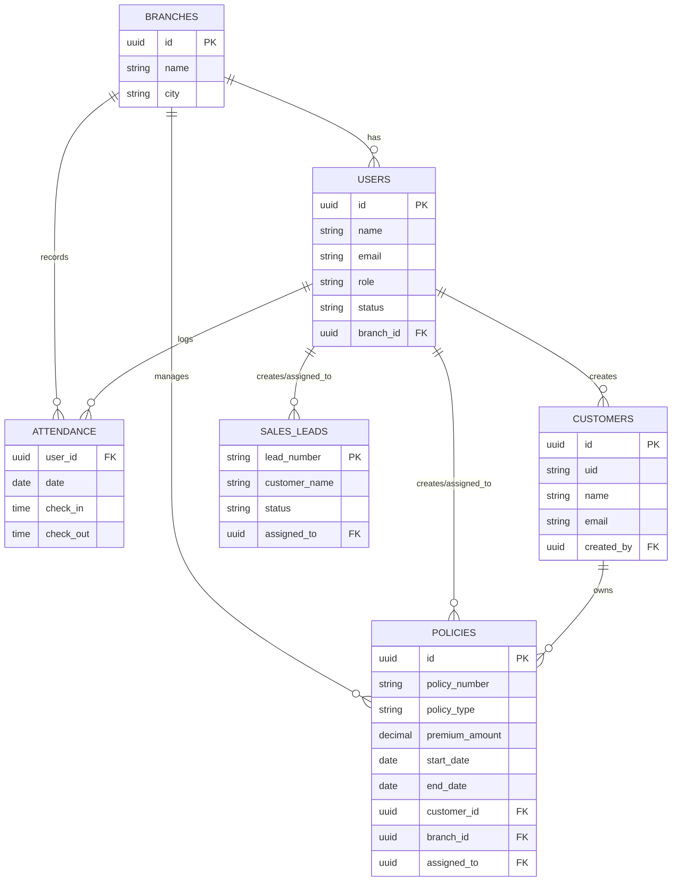

# Research Seminar Report: Next-Generation Insurance Brokerage Management

## 1. Title
**Next-Generation Insurance Brokerage Management: Integrating AI-Powered Document Extraction and Real-Time Workflows in the BAPF Portal**

## 2. Abstract
The rapid digitization of the insurance industry demands robust, scalable, and intelligent systems to manage complex brokerage operations. This report presents the development and architecture of the BP & AF Insurance Broker Portal (BAPF), a comprehensive management system designed to streamline insurance operations. Built on a modern technology stack comprising Next.js, React, and Supabase, the system integrates over 30 core modules including policy lifecycle management, customer relations, and claims processing. A distinguishing feature of this project is the implementation of an AI-powered PDF extraction engine using Google Gemini AI, which automates data entry from complex insurance documents. This report explores the system architecture, proposed functionalities, and the impact of integrating artificial intelligence into traditional brokerage workflows.

## 3. Introduction
Insurance brokerages traditionally face significant operational bottlenecks due to manual data entry, fragmented communication channels, and decentralized document management. The BAPF Insurance Broker Portal was developed to address these inefficiencies by providing a unified, cloud-based platform. The primary objective of the project is to automate repetitive tasks—such as parsing policy documents—while providing real-time business intelligence to managers and employees. By leveraging a modern web architecture (Next.js 16 and Supabase) and artificial intelligence, the system offers a mobile-first, responsive dashboard that handles everything from lead generation and business case pipelines to GPS-based employee attendance and premium tracking.

## 4. Related Work
Existing insurance management systems typically fall into two categories: legacy on-premise software, which lacks modern API integrations and remote accessibility, and generic CRM systems (like Salesforce or Zoho), which require heavy customization to fit the specific needs of an insurance brokerage. 
Recent advancements in InsurTech have focused on:
*   **Cloud-based CRMs:** Allowing decentralized access to customer data.
*   **Automated Underwriting:** Using rules engines to generate quotes.
*   **Optical Character Recognition (OCR):** Early attempts at document parsing relied on standard OCR, which struggles with the highly variable layouts of insurance policies from different carriers.

The BAPF portal builds upon these concepts but replaces rigid OCR with generative AI (Google Gemini) for intelligent, context-aware data extraction, creating a more resilient and accurate unified intake desk.

## 5. Proposed Work in the Project

The proposed work is the complete end-to-end development of the BAPF Insurance Broker Portal. 

### 5.1 Project Structure
The application follows a modern monolithic repository structure with a decoupled API strategy using Next.js App Router.

```text
bapf-portal/
├── app/                          # Next.js App Router (Frontend pages & UI)
│   ├── api/                      # API routes (39 endpoints including extract-pdf)
│   ├── dashboard/                # Main dashboard modules (intake, policies, customers)
│   └── login/                    # Authentication views
├── components/                   # Reusable UI components (shadcn/ui, Radix)
├── lib/                          # Core business logic and integrations
│   ├── services/                 # Business logic services
│   ├── helpers/                  # PDF extraction logic (Gemini AI integration)
│   ├── monitoring/               # Sentry error tracking
│   └── supabase/                 # Database client configurations
├── supabase/                     # Supabase configuration and database migrations
│   └── migrations/               # SQL schemas and table definitions
├── tests/                        # E2E integration and API tests
└── docs/                         # Technical documentation
```

### 5.2 Database Schemas
The backend relies on PostgreSQL hosted by Supabase. Below are the primary entities and their schemas:

*   **Users:** `id` (UUID, PK), `name`, `email`, `role` (Admin/Manager/Employee), `status`, `phone`, `branch_id` (FK), `bio`.
*   **Branches:** `id` (UUID, PK), `name`, `address`, `city`, `state`, `pincode`, `phone`, `is_active`.
*   **Customers:** `id` (UUID, PK), `uid`, `name`, `email`, `phone`, `city`, `status`, `customer_type`, `created_by` (FK).
*   **Policies:** `id` (UUID, PK), `policy_number`, `policy_type`, `customer_id` (FK), `insurer_name`, `premium_amount`, `sum_insured`, `status`, `start_date`, `end_date`, `created_by` (FK), `assigned_to` (FK), `branch_id` (FK).
*   **Sales Leads:** `lead_number` (PK), `customer_name`, `email`, `mobile`, `status`, `source`, `assigned_to` (FK), `created_by` (FK).
*   **Attendance:** `user_id` (FK), `date`, `check_in`, `check_out`, `status`, `branch_id` (FK).
*   **Commission Rules:** `policy_type`, `commission_type`, `value`, `insurer_name`, `is_active`.

### 5.3 Entity-Relationship (ER) Diagram
The data model focuses on robust relational mapping between the workforce (Users/Branches) and the business operations (Customers/Policies/Leads).



## 6. Observations (Advantages and Disadvantages of the Proposed Work)

**Advantages:**
*   **Operational Efficiency:** The AI-powered PDF extraction significantly reduces manual data entry time (processing documents in 10-15 seconds) and minimizes human error in policy generation.
*   **Centralized Ecosystem:** By combining CRM, HR (attendance), and core insurance operations (policies, claims) into one platform, it eliminates the need for multiple disparate software subscriptions.
*   **High Performance and Scalability:** The use of Next.js server components and Supabase ensures page load times under 3 seconds and scalable database query performance.

**Disadvantages (Limitations):**
*   **AI Dependency and Latency:** The PDF extraction process relies on an external API (Google Gemini). High latency can bottleneck the core policy intake workflow.
*   **Complex Implementation:** Maintaining 30+ modules requires stringent testing and a steep learning curve for new developers joining the codebase.

## 7. Results
The deployment of the BAPF portal resulted in a highly functional development build featuring 39 secure API endpoints and robust test coverage. System benchmarks indicate an average API response time of under 200ms. The unified intake desk successfully transforms unstructured PDF policy documents into structured database records, bridging the gap between raw carrier documents and structured brokerage data.

## 8. Conclusion
The BAPF Insurance Broker Portal demonstrates the immense potential of combining modern web frameworks with generative AI in the InsurTech sector. By moving beyond simple CRM capabilities and directly addressing the industry-specific pain point of document processing via AI, the system provides a comprehensive, scalable solution for modern insurance brokerages. Future enhancements, including mobile application development and payment integrations, will further solidify the platform.
