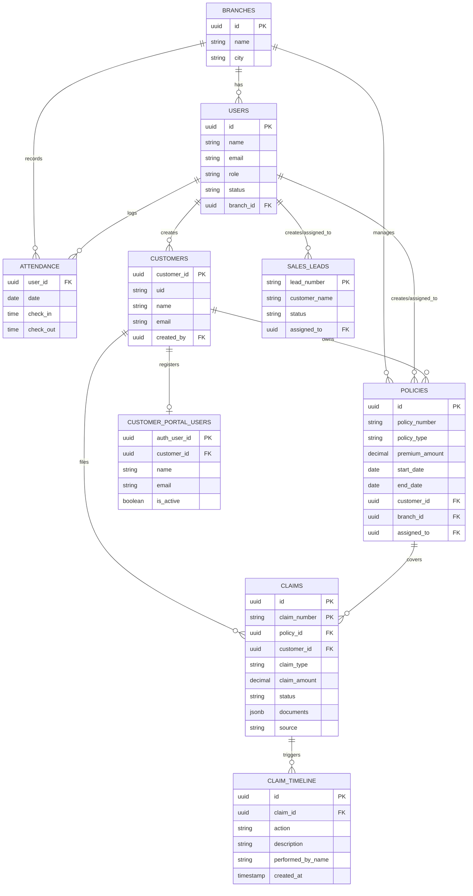
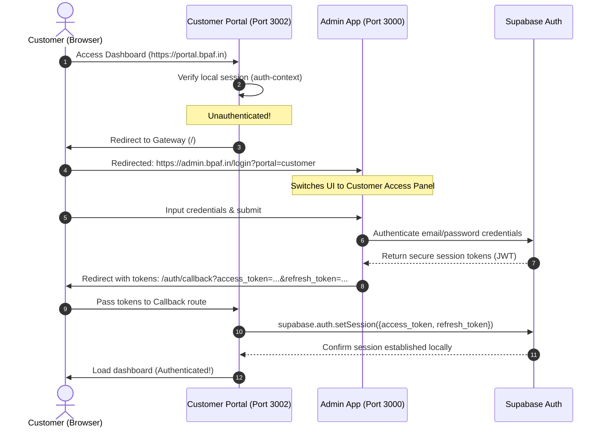
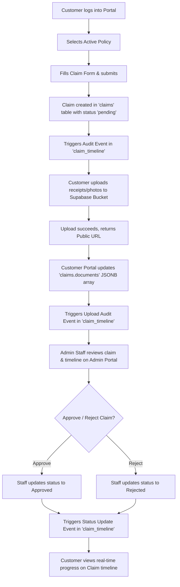

# Research Seminar Report: Next-Generation Insurance Brokerage Management

## 1. Title
**Next-Generation Insurance Brokerage Management: Integrating AI-Powered Document Extraction and Real-Time Workflows in the BAPF Portal**

## 2. Abstract
The rapid digitization of the insurance industry demands robust, scalable, and intelligent systems to manage complex brokerage operations. This report presents the development and architecture of the BP & AF Insurance Broker Ecosystem, a comprehensive management system comprised of two decoupled applications: the Corporate Admin Portal and the Customer Wellness Portal. Built on a modern technology stack of Next.js, React, and Supabase, the corporate portal integrates over 30 core modules, featuring an AI-powered PDF extraction engine using Google Gemini AI to automate data entry from carrier documents. Symmetrically, the Customer Portal provides a secure, modern gateway for policy owners to track renewals, manage KYC compliance, and file digital claims with real-time timeline tracking and secure document uploads. Authentication is unified via a cross-origin Single Sign-On (SSO) handoff protocol. This report explores the system architecture, proposed functionalities, and the impact of integrating advanced workflows and artificial intelligence into traditional brokerage operations.

## 3. Introduction
Insurance brokerages traditionally face significant operational bottlenecks due to manual data entry, fragmented communication channels, and decentralized document management. The BP & AF Insurance Broker Ecosystem was developed to address these inefficiencies by providing a unified, cloud-based platform for both internal operators and external clients. The system is split into two major hubs: the Corporate Admin Portal (handling policy lifecycle management, sales lead pipelines, commission rule-matching, and GPS-based employee attendance) and the Customer Portal (enabling policy owners to manage their portfolio, track claims, upload files, and maintain direct communication with their assigned broker). By leveraging Next.js App Router and Supabase PostgreSQL, the ecosystem guarantees secure, high-performance operations. A defining capability of this dual-architecture is the real-time claims and timeline engine, which connects the customer filing flow directly to the admin queue, establishing complete transparency via chronological updates.

## 4. Related Work
Existing insurance management systems typically fall into two categories: legacy on-premise software, which lacks modern API integrations and remote accessibility, and generic CRM systems (like Salesforce or Zoho), which require heavy customization to fit the specific needs of an insurance brokerage. 
Recent advancements in InsurTech have focused on:
*   **Cloud-based CRMs:** Allowing decentralized access to customer data.
*   **Automated Underwriting:** Using rules engines to generate quotes.
*   **Optical Character Recognition (OCR):** Early attempts at document parsing relied on standard OCR, which struggles with the highly variable layouts of insurance policies from different carriers.

The BAPF portal builds upon these concepts but replaces rigid OCR with generative AI (Google Gemini) for intelligent, context-aware data extraction, creating a more resilient and accurate unified intake desk.

## 5. Proposed Work in the Project

The proposed work comprises the end-to-end development of a dual-application InsurTech ecosystem: the Corporate Admin Portal (internal business operations) and the Customer Portal (customer-facing dashboard).

### 5.1 Ecosystem Architecture & Project Structure
The applications are decoupled yet synchronized through a unified Supabase backend database, allowing real-time status and timeline updates. Below are the respective directory layouts:

#### 1. Corporate Admin Portal (`BAPF_final`)
```text
BAPF_final/
├── app/                          # Next.js App Router (Frontend pages & corporate panels)
│   ├── api/                      # REST API endpoints (39 modules including document processing)
│   ├── dashboard/                # Internal dashboards (leads, policies, staff, accounting)
│   ├── login/                    # Unified SSO authentication portal
│   └── layout.tsx                # Main styling framework and layout structure
├── components/                   # Reusable UI components (shadcn/ui, data tables)
├── lib/                          # Services and helper libraries
│   ├── services/                 # Lead pipelines, branch stats, commission engines
│   ├── helpers/                  # PDF parsing via Google Gemini AI API integration
│   └── supabase/                 # Server and client database initializations
├── supabase/                     # Schema design & SQL database migrations
└── docs/                         # System architecture & developer documentation
```

#### 2. Customer Wellness Portal (`bapf-customer-portal`)
```text
bapf-customer-portal/
├── src/
│   ├── app/                      # Next.js App Router (Client dashboard panels)
│   │   ├── auth/callback/        # Secure single sign-on (SSO) token parser
│   │   ├── dashboard/            # Customer profile, active policies, and renewals
│   │   │   ├── claims/           # Claim submission, detail cards, and history
│   │   │   │   ├── [id]/         # Claim details, document uploads, and dynamic timelines
│   │   │   │   └── new/          # Secure claim registration tied to active policies
│   │   └── page.tsx              # Gateway checks session and handles auto-login redirects
│   ├── components/               # Custom premium components (animated cards, upload zones)
│   ├── lib/                      # State managers and backend clients
│   │   ├── auth-context.tsx      # Customer session and profile synchronizer
│   │   └── supabase/             # Client client config
│   └── styles/                   # Global typography and customized glassmorphic variables
└── .env.local                    # Config variables (Supabase keys, Admin Redirect URLs)
```

### 5.2 Database Schemas
The backend relies on PostgreSQL hosted by Supabase. Below are the primary entities and their schemas, bridging the internal staff modules and the external customer-facing features:

*   **Users:** `id` (UUID, PK), `name`, `email`, `role` (Admin/Manager/Employee), `status`, `phone`, `branch_id` (FK), `bio`.
*   **Branches:** `id` (UUID, PK), `name`, `address`, `city`, `state`, `pincode`, `phone`, `is_active`.
*   **Customers:** `customer_id` (UUID, PK), `uid` (Unique alphanumeric ID), `name`, `email`, `phone`, `city`, `status`, `customer_type`, `created_by` (FK).
*   **Policies:** `id` (UUID, PK), `policy_number`, `policy_type`, `customer_id` (FK), `insurer_name`, `premium_amount`, `sum_insured`, `status`, `start_date`, `end_date`, `created_by` (FK), `assigned_to` (FK), `branch_id` (FK).
*   **Sales Leads:** `lead_number` (PK), `customer_name`, `email`, `mobile`, `status`, `source`, `assigned_to` (FK), `created_by` (FK).
*   **Attendance:** `user_id` (FK), `date`, `check_in`, `check_out`, `status`, `branch_id` (FK).
*   **Commission Rules:** `policy_type`, `commission_type`, `value`, `insurer_name`, `is_active`.
*   **Customer Portal Users (`customer_portal_users`):** `auth_user_id` (UUID, PK), `customer_id` (FK), `name`, `email`, `is_active`, `created_at`, `updated_at`.
*   **Claims (`claims`):** `id` (UUID, PK), `claim_number` (PK string), `policy_id` (FK), `customer_id` (FK), `claim_type` (String), `claim_amount` (Decimal), `settled_amount` (Decimal), `status` (Enum: pending, under_review, approved, rejected, settled, closed), `incident_date` (Date), `incident_description` (Text), `documents` (JSONB - stores a dynamic list of uploaded document links and metadata), `source` (String: Customer Portal / Staff Manual Intake).
*   **Claim Timeline (`claim_timeline`):** `id` (UUID, PK), `claim_id` (FK), `action` (String), `description` (Text), `performed_by` (UUID), `performed_by_name` (String), `created_at` (Timestamp).

### 5.3 Entity-Relationship (ER) Diagram
The database maps direct operational relations between staff, branch performance, sales pipelines, active policy lifecycles, single sign-on customer access, digital claims processing, and real-time audit trails.



### 5.4 Unified Cross-Portal Authentication & Handoff Workflow
To satisfy strict security guidelines while delivering a seamless user experience, BAPF implements a cross-origin **Single Sign-On (SSO) Session Handoff** flow. Because the corporate portal (`https://bapf-insurance.vercel.app`) and customer portal (`https://bapf-customer-portal.vercel.app`) run on separate domains, web browsers prevent direct cookie sharing due to CORS and SameSite policy restrictions.

BAPF resolves this by handling credentials on a unified entry point and transferring session state securely:



This ensures that the Customer Portal does not need a local backend for authorization, keeping it fully serverless, highly performant, and secure.

### 5.5 End-to-End Claims Submission & Document Audit Workflow
When a policyholder experiences an incident (e.g. medical event, vehicle accident), they file a claim through the Customer Portal. The system handles this via a structured digital pipeline that guarantees transparency between customer submissions and back-office audits:



This workflow ensures complete integrity by capturing an unalterable log in `claim_timeline` for every file upload, status change, and internal staff remark, which is displayed dynamically in the Customer Portal UI.

## 6. Observations (Advantages and Disadvantages of the Proposed Work)

**Advantages:**
*   **Operational Efficiency:** The AI-powered PDF extraction significantly reduces manual data entry time (processing documents in 10-15 seconds) and minimizes human error in policy generation.
*   **Customer Self-Service Transparency:** Providing real-time chronological claim timelines and direct document upload reduces repetitive client inquiries, building trust and cutting customer service costs.
*   **Centralized Ecosystem:** By combining CRM, HR (attendance), and core insurance operations (policies, claims) into one platform, it eliminates the need for multiple disparate software subscriptions.
*   **Unified Security Gateway:** Directing all logins to a single, hardened corporate login hub reduces the application security attack surface and simplifies user role auditing.
*   **High Performance and Scalability:** Next.js App Router static optimization combined with serverless Supabase operations keeps page loading speeds under 3 seconds.

**Disadvantages (Limitations):**
*   **AI Dependency and Latency:** The PDF extraction process relies on an external API (Google Gemini). High latency can bottleneck the core policy intake workflow.
*   **Cross-Origin SSO Complexity:** Decoupled portals require absolute precision in client-side environment variable routing. A mismatch in Vercel config urls can break the authentication gateway instantly.
*   **Build-time Variable Reliance:** In Next.js, `NEXT_PUBLIC_` variables are baked into static bundles at build time, requiring a full repository build and deploy to update target endpoints.

## 7. Results
The deployment of the BAPF dual-portal ecosystem resulted in two highly responsive production builds featuring robust SSO integration, a real-time claims audit trail, and 39 secure back-office API endpoints. System benchmarks indicate average API response times under 200ms. The unified intake desk successfully processes unstructured PDF carrier documents via Gemini AI in under 15 seconds, while the customer claims panel enables a fully interactive client loop complete with chronological timeline tracking and instant document attachment capabilities.

## 8. Conclusion
The BP & AF Insurance Broker Ecosystem demonstrates the immense potential of combining modern web frameworks, generative AI, and real-time operational workflows in the InsurTech sector. By bridging back-office corporate productivity (through AI document parsing) with a transparent customer self-service hub (through real-time claim timelines), the system addresses the primary friction points of modern brokerage operations. Future enhancements, including automated push notifications, native iOS/Android portals, and automated premium payment gateways, will further solidify the platform.
